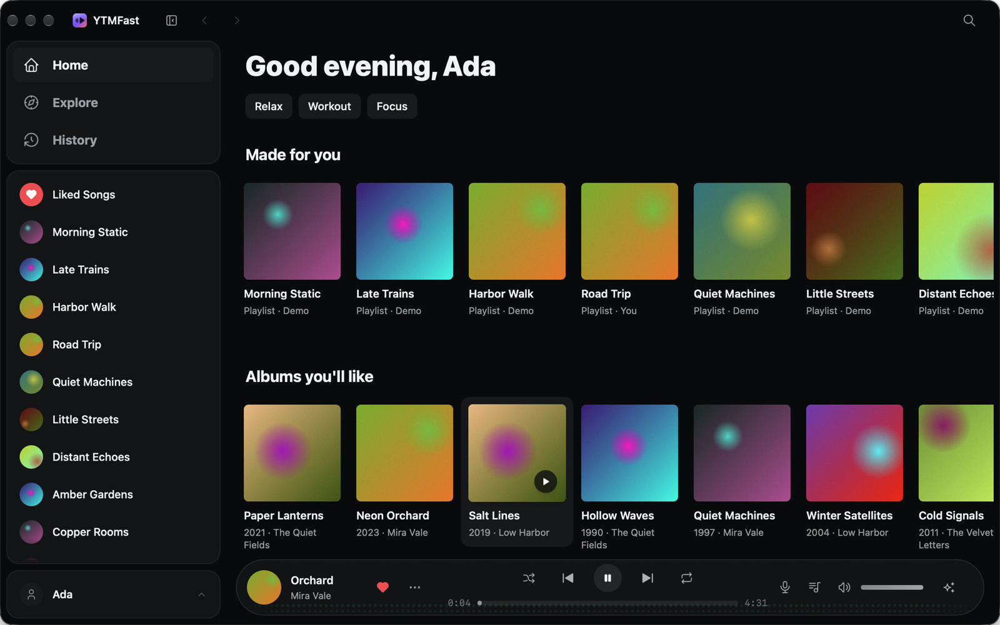
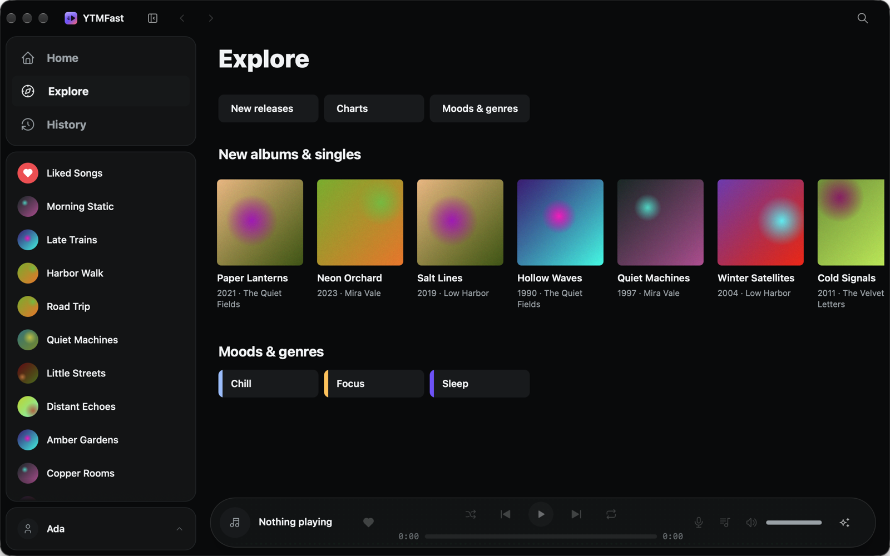
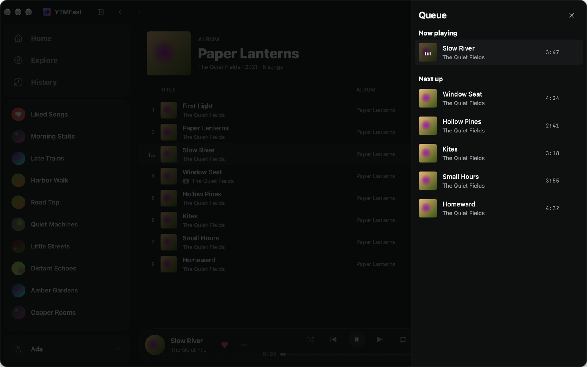

# YTMFast

[](https://github.com/niuguy/ytmfast/actions/workflows/ci.yml)

**An unofficial, native client for YouTube Music, built with [NSH](https://nsh.dev), forked from
[Spotish](https://github.com/huacnlee/spotish).**



YTMFast is a lightweight, native desktop app that works with your Google account. Instead of running YouTube
Music's web app in a full browser window, it runs YouTube Music's own web player out of sight in a browser you
already have installed, and drives it from a fast, native interface drawn by NSH. Your account, free or Premium,
does the playing, so the catalogue, your library and YouTube's ads all work exactly as YouTube intends.

YTMFast is forked from [Spotish](https://github.com/huacnlee/spotish), Jason Lee's native Spotify client built
with NSH: the interface, the design and the engine's browser and DevTools layers are Spotish's. The YouTube Music
engine and bridge are YTMFast's own. See [NOTICE.md](NOTICE.md).

> **Unofficial — not affiliated with, endorsed by or sponsored by YouTube or Google.** YouTube Music is a trademark
> of Google LLC. All music and artwork belong to their rights holders. A Google account is needed to see your
> library, and your use of YouTube Music through this app is subject to
> [YouTube's Terms of Service](https://www.youtube.com/t/terms).
>
> **YTMFast never blocks or skips YouTube's ads.** [YouTube Music Premium](https://www.youtube.com/musicpremium)
> is how you remove them and support the artists you listen to.

## Install

**macOS / Linux** — run in Terminal:

```sh
curl -fsSL https://raw.githubusercontent.com/niuguy/ytmfast/main/scripts/install.sh | bash
```

**Windows** — run in PowerShell:

```powershell
irm https://raw.githubusercontent.com/niuguy/ytmfast/main/scripts/install.ps1 | iex
```

The installer downloads the latest release and verifies its checksum; run it again to update (the app also
offers updates itself). You can also [download a release](https://github.com/niuguy/ytmfast/releases/latest)
manually.

Builds: Apple silicon with macOS 14 or later, x86_64 Linux with GTK 4.14 and glibc 2.39 or later (such as Ubuntu
24.04), and x86_64 Windows. On macOS the app is not notarized; the first launch may need approval in **System
Settings → Privacy & Security**.

## What is NSH?

[NSH (Native Shell)](https://nsh.dev) is a Rust UI framework that renders one app through each platform's own native
views — on macOS, Windows, Linux, iOS, Android, the web and even the terminal. YTMFast, like Spotish before it, is one
Rust engine and one TSX interface, drawn natively, not in a web page.

## Features

- **Home, Explore and Search**: Home's filters (Relax, Workout, …); Explore's new releases, charts, and moods and
  genres; search with suggestions, and tabs for songs, albums, artists, playlists and videos with more pages.
- **The queue**: see what plays next, jump to a song, take one out; *Play next* and *Add to queue* from any song,
  album or playlist.
- **Radio**: a mix from any song, album, playlist or artist.
- **Your library**: Liked Songs, saved albums and playlists, subscriptions and History; save and subscribe from a
  page, like or dislike any song, make playlists and add songs to them, take songs out of your own.
- **Now Playing** with lyrics, the system's media keys, and the music light.
- **A mini player** (desktop): a small window that floats over your other apps, from the player's button, the tray
  or Cmd/Ctrl+Shift+M. Closing the main window while music plays switches to it.

Every song has a menu (its "…" button, or a right click) and so does every album, playlist and artist.

| Explore | The queue |
| --- | --- |
|  |  |

The screenshots show the app's demo data (`YTMFAST_DEMO=1`): made-up music, not YouTube Music's.

## How it works

- The **engine** (`src/ytmusic/`, Rust) starts your browser without a window, loads `music.youtube.com`, and
  drives it over the Chrome DevTools Protocol. Sign-in happens in an ordinary browser window with no automation,
  so Google's sign-in works; the login is kept in YTMFast's own browser profile.
- A small **bridge** (`src/bridge/bridge.js`) runs inside the web player. It asks YouTube Music's own API
  (InnerTube, `/youtubei/v1/…`) for home, search, albums, artists, playlists, the library and lyrics, signed with the
  page's cookies as the page signs its own requests; reports the player's state from `#movie_player` and the player
  bar; and plays things through the page's own navigation.
- The **interface** (TSX, from `App.tsx`) is native NSH: a sidebar workspace that adapts from a desktop layout to a
  phone layout, a player bar, a full-screen Now Playing view, library, search and collection pages.

Items are named by `ytm:<kind>:<id>` URIs: `ytm:track:<videoId>`, `ytm:album:<MPREb_…>`, `ytm:artist:<UC…>`,
`ytm:playlist:<playlistId>`, `ytm:mix:<id>` (a radio or mix, which plays but has no page) and
`ytm:collection:LM` (Liked Music).

## Requirements

- An installed **Google Chrome, Chromium, Microsoft Edge or Brave**. YouTube Music's audio is not encrypted, so no
  Widevine component is needed. Set `YTMFAST_BROWSER` to the browser's executable to choose one.
- A **Google account** for your library (search, albums, artists and public playlists work signed out).

## Build and run

You need the `nsh` CLI (nightly) and Rust 1.95 or later; see [CONTRIBUTING.md](CONTRIBUTING.md#setup).

```sh
nsh run      # run on this machine (builds the Rust engine, bundles the TSX interface)
nsh check    # cargo check + tsc
nsh test     # cargo test + TSX tests
nsh build    # describe the crate and bundle
```

`YTMFAST_DEMO=1 nsh run` runs on sample data, with no browser and no account.

To check the engine and bridge against the real YouTube Music without the interface:

```sh
cargo run --example probe                          # home, a search, an album, an artist, a playlist, lyrics
cargo run --example probe -- search "kites"        # one call
PROBE_WATCH=40 cargo run --example probe -- play ytm:track:<videoId>
```

On first launch, press **Log in** and sign in with Google in the window that opens, then close it. To reuse a
browser you are already signed in to, set `YTMFAST_PROFILE` to that browser's profile directory (for example
`~/Library/Application Support/Google/Chrome`); close that browser while YTMFast runs.

In regions where Google asks for cookie consent, the headless player answers **Reject all** for you, the most
private choice, so the player can load.

## Differences from Spotish

- Free accounts play any song on demand, so a picked song always plays (Spotify Free shuffles instead).
- YouTube Music's shuffle reorders the queue once; it is not a mode, so the shuffle button acts once.
- Lyrics are plain text: YouTube Music's timed lyrics are only for its own apps.

## License

[Apache-2.0](LICENSE-APACHE), as Spotish. See [NOTICE.md](NOTICE.md).
